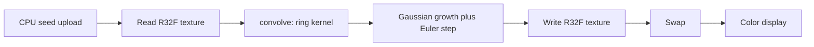

# Lenia WebGL readiness

The WebGL2 scaffold is in place, and each step runs the Orbium update. `KERNEL_READY` is `1` in [src/sim/lenia.ts](src/sim/lenia.ts). `convolve` in [src/sim/glsl.ts](src/sim/glsl.ts) sums the ring kernel.

Lenia's update is:

`A ← clip(A + dt · G(K ∗ A), 0, 1)` with `G(u) = 2 exp(-(u − μ)² / (2σ²)) − 1`

The panel values (μ = 0.15, σ = 0.015, dt = 0.1, R = 13) are Orbium's growth parameters from Bert Chan's Lenia. The ring is a Gaussian shell with μ_K = 0.5 and σ_K = 0.15, built on the CPU, normalized so the weights sum to 1, and uploaded as a small `R32F` texture. The R slider stops at 16, which is the fragment loop's bound.

Random disks in [src/sim/seed.ts](src/sim/seed.ts) shrink and disappear under these parameters. They are not the stable creature.

## Review

What is in good shape:

- Float field as `R32F` with `EXT_color_buffer_float`, ping-pong framebuffers, and nearest sampling on the step. Linear sampling is only used to stretch the field on screen or across a resize.
- Toroidal wrap is already set (`REPEAT` on the sampler). The display shader flips Y so texture row 0 is the top of the canvas; the step samples unflipped texture space, so wrap stays consistent.
- Grid size is CSS pixels divided by `resolution` (default 4), then stretched to the drawing buffer. Reseed, pause, and steps-per-frame already drive the loop in [src/main.ts](src/main.ts).

What to leave alone for this step:

- Radii above 16 still want a different convolution later, not a bigger fragment loop.
- There is no pixel readback or test runner. The CPU kernel builder already checks that the weights sum to 1.
- [biome.json](biome.json) has `"root": false` so formatting expects a parent config, as the README says.

## Next small step

Replace the random disks with Bert Chan's Orbium creature.

1. Stamp the published Orbium cell patch into the field in [src/sim/seed.ts](src/sim/seed.ts). It is one fixed array of values in `[0, 1]`, the pattern that glides at R = 13 with the current μ, σ, and dt.
2. Place one copy on the torus. Randomize moves that copy. Do not go back to smooth disks.
3. Keep the patch at its native size for R = 13. Do not scale it when the radius slider moves.

No animal picker, no extra sliders, no FFT.

After that, run the page: the pattern should persist and travel, instead of fading out within a second.
