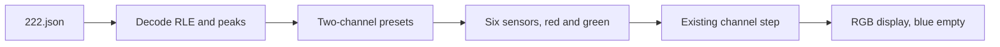

# Next: two-channel creatures

One-channel animals and the three-channel Aquarium presets already run. The next work is to add Bert Chan’s published two-channel solitons from [`222.json`](https://github.com/Chakazul/Lenia/blob/master/Python/found/222.json).

Two channels is the smallest rule where one channel can be a core and the other a body. Cross-sensors hold the pair together. The update is the same as Aquarium:

`A_dest ← clip(A_dest + dt · Σ (h / H_dest) · G(K ∗ A_source), 0, 1)`

`H_dest` is the sum of strengths writing into that destination. Growth and rings stay polynomial (`kn = 1`, `gn = 1` in Chan’s LeniaNDKC, which is already what [src/sim/glsl.ts](src/sim/glsl.ts) `CHANNEL_FRAG` and [src/sim/kernel.ts](src/sim/kernel.ts) `buildRingShell` do). Blue stays empty.

## What to ship

Nine genotypes, each with six sensors (two self-rules per channel, plus one each way). Time step is `1 / T = 0.1`. Missing `h` is 1. Missing `r` is 1, so every sensor uses the full base radius. `b` is the ring heights.

| Code      | Name in the file | R   | Why it is here                         |
| --------- | ---------------- | --- | -------------------------------------- |
| Found #5  | object           | 20  | Only named one. Two overlapping blobs. |
| Found #29 |                  | 20  | Compact pair.                          |
| Found #30 |                  | 15  | Compact, fits today’s radius cap.      |
| Found #33 |                  | 15  | Longer body.                           |
| Found #8  |                  | 20  | Larger soliton.                        |
| Found #19 |                  | 20  | Large field.                           |
| Found #20 |                  | 20  | Large field.                           |
| Found #35 |                  | 15  | Large field.                           |
| (none)    | pattern          | 14  | Smallest radius.                       |

Decode every pattern. Add a button for each one that stays alive after Play. Drop any that die or flood. Expect a few compact ones to survive (`object`, #29, #30) and do not invent replacements.

## Work

### 1 — Radius 20

Several animals were found at `R = 20`. [src/sim/kernel.ts](src/sim/kernel.ts) `MAX_KERNEL_RADIUS` is 18, and `clampKernelRadius` would shrink those kernels and likely kill them. Raise the cap to 20. Six sensors at radius 20 is still cheaper than Aquarium’s fifteen sensors at radius 12.

### 2 — Decode Chan’s strings into presets

Chan stores each channel as one RLE string. `.` and `b` are 0, `o` is 1, a single letter `A`–`X` is `(code − 'A' + 1) / 255`, and a two-letter token like `yO` is `((first − 'p') · 24 + (second − 'A' + 25)) / 255`. Digits are run counts. `$` starts the next row. `!` ends the grid.

Write a one-off decoder (do not run it in the browser). Emit TypeScript grids in a new file next to [src/sim/aquarium.ts](src/sim/aquarium.ts), same `ChannelCreature` shape. Third channel is zeros. Parse `b` with the same fractions Aquarium already uses (`1`, `2/3`, `5/6`, …).

`prepareChannelRule` already normalizes strengths per destination. Six sensors of strength 1 is enough.

### 3 — Panel

Add a **Two channels** folder beside **Three channels** in [src/ui/controls.ts](src/ui/controls.ts). Same gesture as Aquarium: load the genotype, stamp the pattern, do not clear first. One-channel sliders stay as they are. Do not add six new sliders.

Randomize may keep filling all three channels while a channel rule is live. Blue has no sensor, so leftover blue is unused. Optional: fill only red and green for a two-channel rule.

### 4 — Check in the browser

For each button: Reset to empty, add while paused (red and green blob, not the one-channel color ramp), Play, wait a few seconds. Keep it if the pair holds together or glides. Remove it if the field goes black or fills the screen.

Then add Orbium and confirm the color ramp comes back. Then add an Aquarium preset and confirm three-channel still works.

## Leave alone

- Aquarium sensors, seeds, and buttons.
- The one-channel animals and their sliders.
- Rust / WASM. That is still a later port of the same rules, not this step.
- New two-channel genotypes. Only `222.json`.
