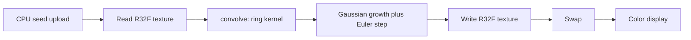
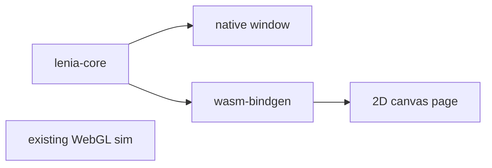

# Lenia WebGL readiness

The WebGL2 scaffold is in place, and each step runs the Orbium update. `KERNEL_READY` is `1` in [src/sim/lenia.ts](src/sim/lenia.ts). `convolve` in [src/sim/glsl.ts](src/sim/glsl.ts) sums the ring kernel.

Lenia's update is:

`A ← clip(A + dt · G(K ∗ A), 0, 1)` with `G(u) = 2 exp(-(u − μ)² / (2σ²)) − 1`

The panel values (μ = 0.15, σ = 0.015, dt = 0.1, R = 13) are Orbium's growth parameters from Bert Chan's Lenia. The ring is a Gaussian shell with μ_K = 0.5 and σ_K = 0.15, built on the CPU, normalized so the weights sum to 1, and uploaded as a small `R32F` texture. The R slider stops at 16, which is the fragment loop's bound.

Random disks in [src/sim/seed.ts](src/sim/seed.ts) shrink and disappear under these parameters. They are not the stable creature.

## Review

What is in good shape:

- Float field as `R32F` with `EXT_color_buffer_float`, ping-pong framebuffers, and nearest sampling on the step. Linear sampling is only used to stretch the field on screen or across a resize.
- Toroidal wrap is already set (`REPEAT` on the sampler). The display shader flips Y so texture row 0 is the top of the canvas; the step samples unflipped texture space, so wrap stays consistent.
- Grid size is CSS pixels divided by `resolution` (default 4), then stretched to the drawing buffer. Reseed, pause, and steps-per-frame already drive the loop in [src/main.ts](src/main.ts).

What to leave alone for this step:

- Radii above 16 still want a different convolution later, not a bigger fragment loop.
- There is no pixel readback or test runner. The CPU kernel builder already checks that the weights sum to 1.
- [biome.json](biome.json) has `"root": false` so formatting expects a parent config, as the README says.

## Next small step

Replace the random disks with Bert Chan's Orbium creature.

1. Stamp the published Orbium cell patch into the field in [src/sim/seed.ts](src/sim/seed.ts). It is one fixed array of values in `[0, 1]`, the pattern that glides at R = 13 with the current μ, σ, and dt.
2. Place one copy on the torus. Randomize moves that copy. Do not go back to smooth disks.
3. Keep the patch at its native size for R = 13. Do not scale it when the radius slider moves.

No animal picker, no extra sliders, no FFT.

After that, run the page: the pattern should persist and travel, instead of fading out within a second.

## Later: Rust core, then WASM

A standalone Rust version is a small port, and the browser version can be the same crate compiled to WASM. The rules already live in a few pure functions: the ring in [src/sim/kernel.ts](src/sim/kernel.ts), the seed in [src/sim/seed.ts](src/sim/seed.ts), and the update in the shader in [src/sim/glsl.ts](src/sim/glsl.ts).

WebGL textures, ping-pong, and the panel do not move. A GPU rewrite (wgpu / WGSL) that matches today's shaders is a later project, not these steps.

Direct convolution at R = 13 is fine on a fixed grid around 128×128 or 256×256. Full-window grids stay on the WebGL page.

### Step 1 — library and tests

Add `crates/lenia-core` with no window and no WASM. It owns:

- Orbium params (μ = 0.15, σ = 0.015, dt = 0.1, R = 13, kernel peaks μ_K = 0.5, σ_K = 0.15)
- `build_ring_kernel` and a toroidal seed, copied from the TypeScript
- a double-buffered `Vec<f32>` and `step`

Tests: weights sum to 1, values stay in `[0, 1]`, a 1-cell kernel matches a hand-computed step. `cargo test` is the whole milestone.

### Step 2 — native window

Add a binary in the same crate (or `crates/lenia`) that allocates one fixed grid, seeds it, and draws each step into a small window (`winit` + `softbuffer` is enough). Hardcoded Orbium params. Space toggles pause. No sliders.

### Step 3 — same crate in the browser

Build the library as a `cdylib` with `wasm-bindgen`: construct a grid, `step`, and borrow the field as a `Float32Array`. A second Vite page paints that buffer on a 2D canvas with the same color ramp as `DISPLAY_FRAG`. The WebGL app in [src/main.ts](src/main.ts) stays as it is.

Vite already builds this repo, so the WASM bundle is an import on that second page, not a separate site.
