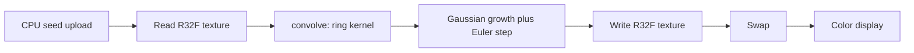

# Lenia WebGL readiness

The project is ready for the simulation itself. Canvas, WebGL2, float ping-pong, resize, display, and the parameter panel are already wired. What is left is the neighborhood sum inside `convolve` in [src/sim/glsl.ts](src/sim/glsl.ts).

Lenia's update is already written in the shader:

`A ← clip(A + dt · G(K ∗ A), 0, 1)` with `G(u) = 2 exp(-(u − μ)² / (2σ²)) − 1`

`KERNEL_READY` is `0` in [src/sim/lenia.ts](src/sim/lenia.ts), so each step mixes back to a copy of `A`. The panel values (μ = 0.15, σ = 0.015, dt = 0.1, R = 13) are Orbium's growth parameters from Bert Chan's Lenia. The kernel peaks are not in the code yet. Orbium's ring is a Gaussian shell with μ_K = 0.5 and σ_K = 0.15, normalized so the weights sum to 1.

## Review

What is in good shape:

- Float field as `R32F` with `EXT_color_buffer_float`, ping-pong framebuffers, and nearest sampling on the step. Linear sampling is only used to stretch the field on screen or across a resize.
- Toroidal wrap is already set (`REPEAT` on the sampler). The display shader flips Y so texture row 0 is the top of the canvas; the step samples unflipped texture space, so wrap stays consistent.
- Uniforms that the stub kernel barely uses (`u_texelSize`, `u_radius`) are still referenced, so the linker cannot strip them before the real kernel needs them.
- Grid size is CSS pixels divided by `resolution` (default 4), then stretched to the drawing buffer. Reseed, pause, and steps-per-frame already drive the loop in [src/main.ts](src/main.ts).

What to leave alone for this step:

- The R slider goes to 64. A fragment loop of radius 64 is `(129)²` taps per cell and will not stay interactive. Orbium's R = 13 is about `27²` taps and is the right first kernel. Larger radii want a different convolution later, not a bigger loop now.
- Random smooth disks in [src/sim/seed.ts](src/sim/seed.ts) are enough to see the field move. The classic Orbium creature is a specific pattern and can be a later seed.
- There is no pixel readback or test runner. A CPU check that the kernel weights sum to 1 is enough for this step.
- [biome.json](biome.json) has `"root": false` so formatting expects a parent config, as the README says.

## Next small step

Add the Orbium ring and turn the step on.

1. Build the kernel on the CPU for the current integer radius: for each offset inside the `(2R+1)` square, `r = length(offset) / R`, weight `exp(-½ ((r − 0.5) / 0.15)²)` when `r ≤ 1`, otherwise `0`, then divide by the sum.
2. Upload that array as a small `R32F` texture. Rebuild it only when R changes.
3. Replace `convolve` so each cell sums `weight(dx, dy) * A(uv + (dx, dy) * texelSize)` with wrap. Bound the GLSL loops with a constant max radius of 16, and clamp the R slider to that max so the UI cannot ask for samples the shader skips.
4. Set `KERNEL_READY` to `1`.

Hardcode μ_K and σ_K. No new sliders, no FFT, no creature atlas.

After that, run the page: the disks should stop being a frozen picture and start growing, shrinking, or breaking apart as μ, σ, and dt move.
